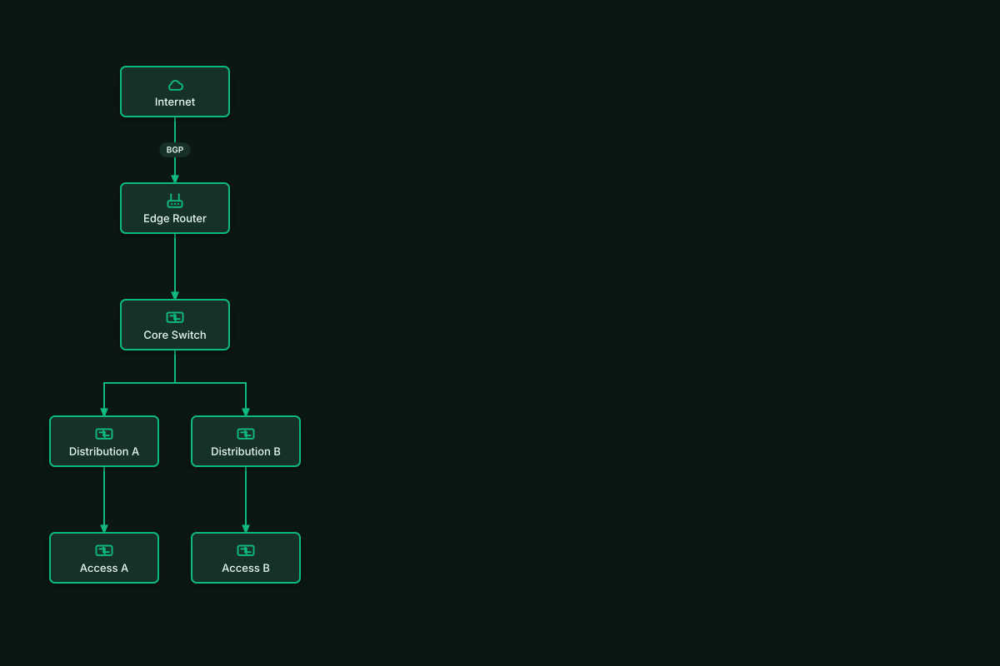

# Auto-Laid-Out Campus Core

## Bill of Materials

| Symbol / ID | Label | Kind | Group | Technical Notes / Metadata |
| :--- | :--- | :--- | :--- | :--- |
| `shape_1` | **Internet** | box | - | - |
| `shape_2` | **Edge Router** | box | - | - |
| `shape_3` | **Core Switch** | box | - | - |
| `shape_4` | **Distribution A** | box | - | - |
| `shape_5` | **Distribution B** | box | - | - |
| `shape_6` | **Access A** | box | - | - |
| `shape_7` | **Access B** | box | - | - |

## Connections

| Source | Target | Protocol / Label | Style | Routing |
| :--- | :--- | :--- | :--- | :--- |
| **Internet** (`shape_1`) | **Edge Router** (`shape_2`) | BGP | solid | orthogonal |
| **Edge Router** (`shape_2`) | **Core Switch** (`shape_3`) | - | solid | orthogonal |
| **Core Switch** (`shape_3`) | **Distribution A** (`shape_4`) | - | solid | orthogonal |
| **Core Switch** (`shape_3`) | **Distribution B** (`shape_5`) | - | solid | orthogonal |
| **Distribution A** (`shape_4`) | **Access A** (`shape_6`) | - | solid | orthogonal |
| **Distribution B** (`shape_5`) | **Access B** (`shape_7`) | - | solid | orthogonal |
