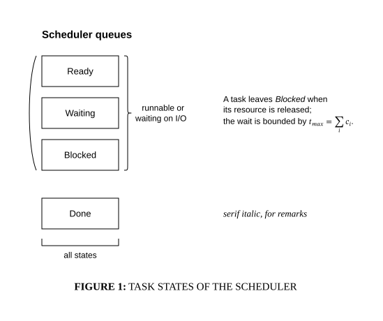

# Text, caption and brackets

## Bill of Materials

| Symbol / ID | Label | Kind | Group | Technical Notes / Metadata |
| :--- | :--- | :--- | :--- | :--- |
| `shape_2` | **Ready** | box | - | - |
| `shape_3` | **Waiting** | box | - | - |
| `shape_4` | **Blocked** | box | - | - |
| `shape_5` | **Done** | box | - | - |
