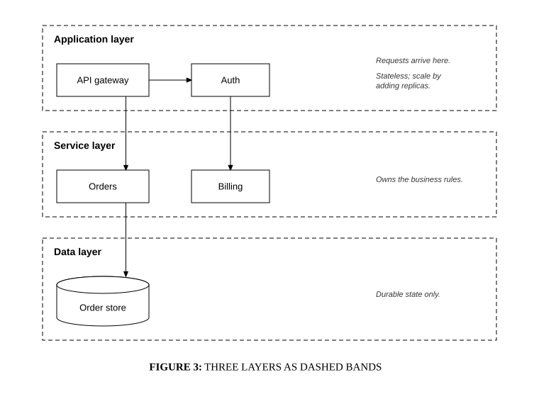

# Layer bands

## Bill of Materials

| Symbol / ID | Label | Kind | Group | Technical Notes / Metadata |
| :--- | :--- | :--- | :--- | :--- |
| `shape_2` | **API gateway** | box | Application layer | - |
| `shape_3` | **Auth** | box | Application layer | - |
| `shape_5` | **Orders** | box | Service layer | - |
| `shape_6` | **Billing** | box | Service layer | - |
| `shape_8` | **Order store** | cylinder | Data layer | - |

## Connections

| Source | Target | Protocol / Label | Style | Routing |
| :--- | :--- | :--- | :--- | :--- |
| **API gateway** (`shape_2`) | **Auth** (`shape_3`) | - | solid | orthogonal |
| **API gateway** (`shape_2`) | **Orders** (`shape_5`) | - | solid | orthogonal |
| **Auth** (`shape_3`) | **Billing** (`shape_6`) | - | solid | orthogonal |
| **Orders** (`shape_5`) | **Order store** (`shape_8`) | - | solid | orthogonal |
