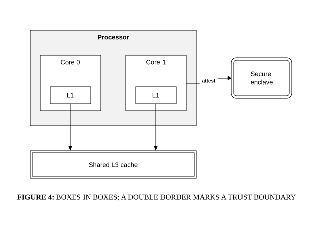

# Nesting and double borders

## Bill of Materials

| Symbol / ID | Label | Kind | Group | Technical Notes / Metadata |
| :--- | :--- | :--- | :--- | :--- |
| `shape_1` | ****Processor**** | box | - | - |
| `shape_2` | **Core 0** | box | **Processor** | - |
| `shape_3` | **Core 1** | box | **Processor** | - |
| `shape_4` | **L1** | box | Core 0 | - |
| `shape_5` | **L1** | box | Core 1 | - |
| `shape_6` | **Shared L3 cache** | box | - | - |
| `shape_7` | **Secure enclave** | box | - | - |

## Connections

| Source | Target | Protocol / Label | Style | Routing |
| :--- | :--- | :--- | :--- | :--- |
| **L1** (`shape_4`) | **Shared L3 cache** (`shape_6`) | - | solid | orthogonal |
| **L1** (`shape_5`) | **Shared L3 cache** (`shape_6`) | - | solid | orthogonal |
| **Core 1** (`shape_3`) | **Secure enclave** (`shape_7`) | attest | solid | orthogonal |
