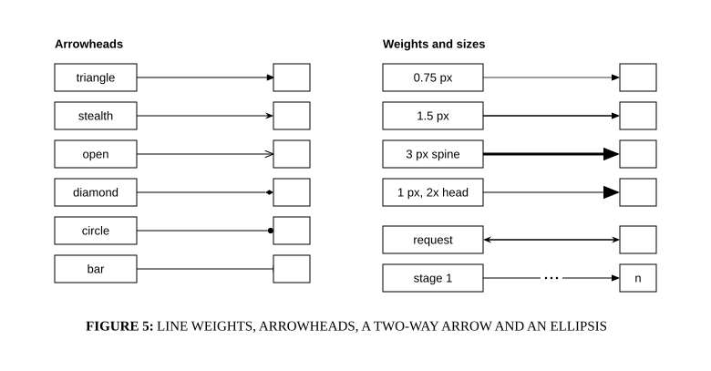

# Edge weights and arrowheads

## Bill of Materials

| Symbol / ID | Label | Kind | Group | Technical Notes / Metadata |
| :--- | :--- | :--- | :--- | :--- |
| `shape_2` | **triangle** | box | - | - |
| `shape_3` | **** | box | - | - |
| `shape_4` | **stealth** | box | - | - |
| `shape_5` | **** | box | - | - |
| `shape_6` | **open** | box | - | - |
| `shape_7` | **** | box | - | - |
| `shape_8` | **diamond** | box | - | - |
| `shape_9` | **** | box | - | - |
| `shape_10` | **circle** | box | - | - |
| `shape_11` | **** | box | - | - |
| `shape_12` | **bar** | box | - | - |
| `shape_13` | **** | box | - | - |
| `shape_15` | **0.75 px** | box | - | - |
| `shape_16` | **** | box | - | - |
| `shape_17` | **1.5 px** | box | - | - |
| `shape_18` | **** | box | - | - |
| `shape_19` | **3 px spine** | box | - | - |
| `shape_20` | **** | box | - | - |
| `shape_21` | **1 px, 2x head** | box | - | - |
| `shape_22` | **** | box | - | - |
| `shape_23` | **request** | box | - | - |
| `shape_24` | **** | box | - | - |
| `shape_25` | **stage 1** | box | - | - |
| `shape_26` | **n** | box | - | - |

## Connections

| Source | Target | Protocol / Label | Style | Routing |
| :--- | :--- | :--- | :--- | :--- |
| **triangle** (`shape_2`) | **shape_3** (`shape_3`) | - | solid | orthogonal |
| **stealth** (`shape_4`) | **shape_5** (`shape_5`) | - | solid | orthogonal |
| **open** (`shape_6`) | **shape_7** (`shape_7`) | - | solid | orthogonal |
| **diamond** (`shape_8`) | **shape_9** (`shape_9`) | - | solid | orthogonal |
| **circle** (`shape_10`) | **shape_11** (`shape_11`) | - | solid | orthogonal |
| **bar** (`shape_12`) | **shape_13** (`shape_13`) | - | solid | orthogonal |
| **0.75 px** (`shape_15`) | **shape_16** (`shape_16`) | - | solid | orthogonal |
| **1.5 px** (`shape_17`) | **shape_18** (`shape_18`) | - | solid | orthogonal |
| **3 px spine** (`shape_19`) | **shape_20** (`shape_20`) | - | solid | orthogonal |
| **1 px, 2x head** (`shape_21`) | **shape_22** (`shape_22`) | - | solid | orthogonal |
| **request** (`shape_23`) | **shape_24** (`shape_24`) | - | solid | orthogonal |
| **stage 1** (`shape_25`) | **n** (`shape_26`) | - | solid | orthogonal |
