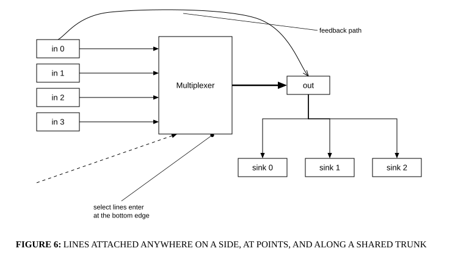

# Anchors, leaders and splines

## Bill of Materials

| Symbol / ID | Label | Kind | Group | Technical Notes / Metadata |
| :--- | :--- | :--- | :--- | :--- |
| `shape_1` | **Multiplexer** | box | - | - |
| `shape_2` | **in 0** | box | - | - |
| `shape_3` | **in 1** | box | - | - |
| `shape_4` | **in 2** | box | - | - |
| `shape_5` | **in 3** | box | - | - |
| `shape_6` | **out** | box | - | - |
| `shape_7` | **sink 0** | box | - | - |
| `shape_8` | **sink 1** | box | - | - |
| `shape_9` | **sink 2** | box | - | - |

## Connections

| Source | Target | Protocol / Label | Style | Routing |
| :--- | :--- | :--- | :--- | :--- |
| **in 0** (`shape_2`) | **Multiplexer** (`shape_1`) | - | solid | orthogonal |
| **in 1** (`shape_3`) | **Multiplexer** (`shape_1`) | - | solid | orthogonal |
| **in 2** (`shape_4`) | **Multiplexer** (`shape_1`) | - | solid | orthogonal |
| **in 3** (`shape_5`) | **Multiplexer** (`shape_1`) | - | solid | orthogonal |
| **Multiplexer** (`shape_1`) | **out** (`shape_6`) | - | solid | orthogonal |
| **out** (`shape_6`) | **sink 0** (`shape_7`) | - | solid | orthogonal |
| **out** (`shape_6`) | **sink 1** (`shape_8`) | - | solid | orthogonal |
| **out** (`shape_6`) | **sink 2** (`shape_9`) | - | solid | orthogonal |
| **point_10** (`point_10`) | **Multiplexer** (`shape_1`) | - | dashed | direct |
| **in 0** (`shape_2`) | **out** (`shape_6`) | - | solid | spline |
| **select lines enter at the bottom edge** (`text_11`) | **Multiplexer** (`shape_1`) | - | solid | direct |
| **feedback path** (`text_12`) | **point_13** (`point_13`) | - | solid | direct |
