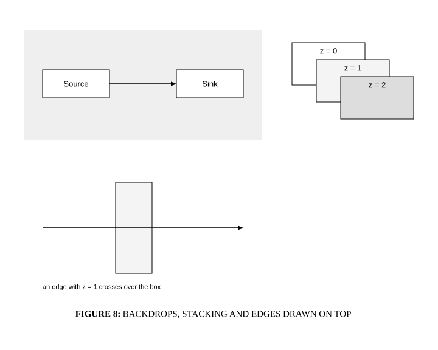

# Z-order

## Bill of Materials

| Symbol / ID | Label | Kind | Group | Technical Notes / Metadata |
| :--- | :--- | :--- | :--- | :--- |
| `shape_2` | **Source** | box | - | - |
| `shape_3` | **Sink** | box | - | - |
| `shape_4` | **z = 2** | box | - | - |
| `shape_5` | **z = 0** | box | - | - |
| `shape_6` | **z = 1** | box | - | - |
| `shape_7` | **** | box | - | - |

## Connections

| Source | Target | Protocol / Label | Style | Routing |
| :--- | :--- | :--- | :--- | :--- |
| **Source** (`shape_2`) | **Sink** (`shape_3`) | - | solid | orthogonal |
| **point_8** (`point_8`) | **point_9** (`point_9`) | - | solid | direct |
