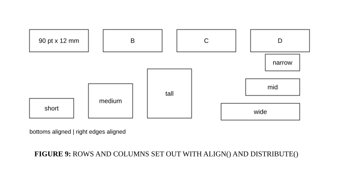

# Alignment, grid and units

## Bill of Materials

| Symbol / ID | Label | Kind | Group | Technical Notes / Metadata |
| :--- | :--- | :--- | :--- | :--- |
| `shape_1` | **90 pt x 12 mm** | box | - | - |
| `shape_2` | **B** | box | - | - |
| `shape_3` | **C** | box | - | - |
| `shape_4` | **D** | box | - | - |
| `shape_5` | **short** | box | - | - |
| `shape_6` | **medium** | box | - | - |
| `shape_7` | **tall** | box | - | - |
| `shape_8` | **wide** | box | - | - |
| `shape_9` | **mid** | box | - | - |
| `shape_10` | **narrow** | box | - | - |
