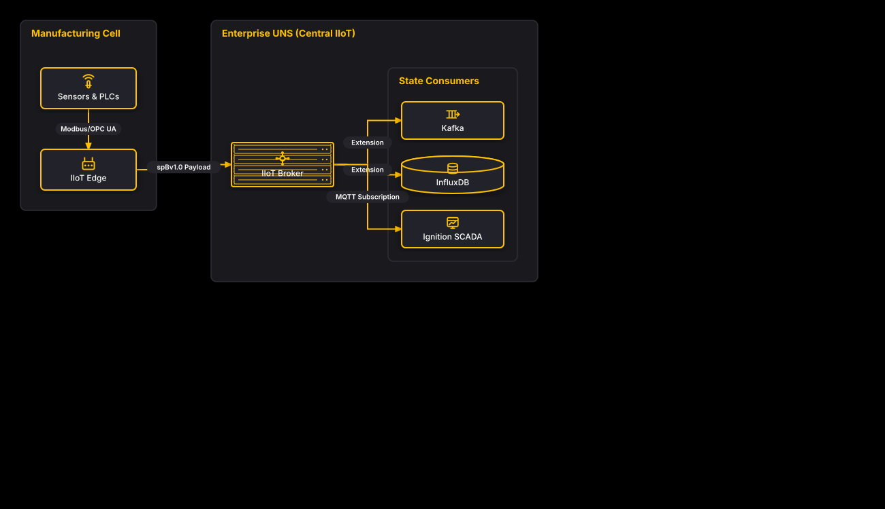

# IIoT Unified Namespace (UNS) with Sparkplug B

## Bill of Materials

| Symbol / ID | Label | Kind | Group | Technical Notes / Metadata |
| :--- | :--- | :--- | :--- | :--- |
| `shape_2` | **Sensors & PLCs** | box | Manufacturing Cell | data: Raw Field Telemetry, bus: Modbus / OPC UA |
| `shape_3` | **IIoT Edge** | box | Manufacturing Cell | role: Sparkplug B Host / EoN, format: Protobuf spBv1.0 |
| `shape_5` | **IIoT Broker** | server_rack | Enterprise UNS (Central IIoT) | role: State Provider, namespace: spBv1.0/Plant1 |
| `shape_7` | **Kafka** | box | State Consumers | system: Event Streaming Data Lake |
| `shape_8` | **InfluxDB** | cylinder | State Consumers | system: Time-Series Historian |
| `shape_9` | **Ignition SCADA** | box | State Consumers | system: Primary Operational HMI/SCADA |

## Connections

| Source | Target | Protocol / Label | Style | Routing |
| :--- | :--- | :--- | :--- | :--- |
| **Sensors & PLCs** (`shape_2`) | **IIoT Edge** (`shape_3`) | Modbus/OPC UA | solid | orthogonal |
| **IIoT Edge** (`shape_3`) | **IIoT Broker** (`shape_5`) | spBv1.0 Payload | solid | orthogonal |
| **IIoT Broker** (`shape_5`) | **Kafka** (`shape_7`) | Extension | solid | orthogonal |
| **IIoT Broker** (`shape_5`) | **InfluxDB** (`shape_8`) | Extension | solid | orthogonal |
| **IIoT Broker** (`shape_5`) | **Ignition SCADA** (`shape_9`) | MQTT Subscription | solid | orthogonal |
