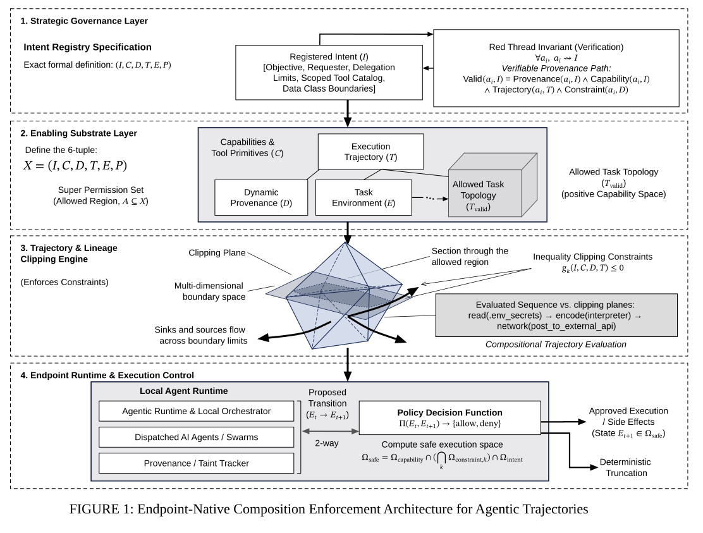

# Composition enforcement architecture

## Bill of Materials

| Symbol / ID | Label | Kind | Group | Technical Notes / Metadata |
| :--- | :--- | :--- | :--- | :--- |
| `shape_6` | **Registered Intent ($I$) [Objective, Requester, Delegation Limits, Scoped Tool Catalog, Data Class Boundaries]** | box | 1. Strategic Governance Layer | - |
| `shape_7` | **Red Thread Invariant (Verification) $\forall a_i,\; a_i \leadsto I$ *Verifiable Provenance Path:* Valid$(a_i, I)$ = Provenance$(a_i, I) \land$ Capability$(a_i, I)$ $\land$ Trajectory$(a_i, T) \land$ Constraint$(a_i, D)$** | box | 1. Strategic Governance Layer | - |
| `shape_14` | **** | box | 2. Enabling Substrate Layer | - |
| `shape_16` | **Execution Trajectory ($T$)** | box | - | - |
| `shape_17` | **Dynamic Provenance ($D$)** | box | - | - |
| `shape_18` | **Task Environment ($E$)** | box | - | - |
| `shape_34` | **Evaluated Sequence vs. clipping planes: read(.env_secrets) → encode(interpreter) → network(post_to_external_api)** | box | 3. Trajectory & Lineage Clipping Engine | - |
| `shape_40` | **** | box | 4. Endpoint Runtime & Execution Control | - |
| `shape_42` | **Agentic Runtime & Local Orchestrator** | box | - | - |
| `shape_43` | **Dispatched AI Agents / Swarms** | box | - | - |
| `shape_44` | **Provenance / Taint Tracker** | box | - | - |
| `shape_47` | ****Policy Decision Function** $\Pi(E_t, E_{t+1}) \to \{\mathrm{allow}, \mathrm{deny}\}$** | box | - | - |

## Connections

| Source | Target | Protocol / Label | Style | Routing |
| :--- | :--- | :--- | :--- | :--- |
| **Clipping Plane** (`text_27`) | **point_28** (`point_28`) | - | solid | direct |
| **Section through the allowed region** (`text_29`) | **point_30** (`point_30`) | - | solid | direct |
| **Multi-dimensional boundary space** (`text_31`) | **point_32** (`point_32`) | - | solid | direct |
| **Registered Intent ($I$) [Objective, Requester, Delegation Limits, Scoped Tool Catalog, Data Class Boundaries]** (`shape_6`) | **point_51** (`point_51`) | - | solid | orthogonal |
| **point_52** (`point_52`) | **point_53** (`point_53`) | - | solid | direct |
| **point_54** (`point_54`) | **point_55** (`point_55`) | - | solid | direct |
| **Registered Intent ($I$) [Objective, Requester, Delegation Limits, Scoped Tool Catalog, Data Class Boundaries]** (`shape_6`) | **Red Thread Invariant (Verification) $\forall a_i,\; a_i \leadsto I$ *Verifiable Provenance Path:* Valid$(a_i, I)$ = Provenance$(a_i, I) \land$ Capability$(a_i, I)$ $\land$ Trajectory$(a_i, T) \land$ Constraint$(a_i, D)$** (`shape_7`) | - | solid | direct |
| **Red Thread Invariant (Verification) $\forall a_i,\; a_i \leadsto I$ *Verifiable Provenance Path:* Valid$(a_i, I)$ = Provenance$(a_i, I) \land$ Capability$(a_i, I)$ $\land$ Trajectory$(a_i, T) \land$ Constraint$(a_i, D)$** (`shape_7`) | **Registered Intent ($I$) [Objective, Requester, Delegation Limits, Scoped Tool Catalog, Data Class Boundaries]** (`shape_6`) | - | solid | orthogonal |
| **Execution Trajectory ($T$)** (`shape_16`) | **Dynamic Provenance ($D$)** (`shape_17`) | - | solid | direct |
| **Execution Trajectory ($T$)** (`shape_16`) | **Task Environment ($E$)** (`shape_18`) | - | solid | direct |
| **Execution Trajectory ($T$)** (`shape_16`) | **solid_19** (`solid_19`) | - | solid | direct |
| **Task Environment ($E$)** (`shape_18`) | **solid_19** (`solid_19`) | - | solid | orthogonal |
| **point_56** (`point_56`) | **point_57** (`point_57`) | - | solid | spline |
| **point_58** (`point_58`) | **point_59** (`point_59`) | - | solid | spline |
| **point_60** (`point_60`) | **point_61** (`point_61`) | - | solid | spline |
| **point_62** (`point_62`) | **point_63** (`point_63`) | - | solid | direct |
| **point_64** (`point_64`) | **point_65** (`point_65`) | - | solid | direct |
| **Evaluated Sequence vs. clipping planes: read(.env_secrets) → encode(interpreter) → network(post_to_external_api)** (`shape_34`) | **point_66** (`point_66`) | - | solid | direct |
| **point_68** (`point_68`) | ****Policy Decision Function** $\Pi(E_t, E_{t+1}) \to \{\mathrm{allow}, \mathrm{deny}\}$** (`shape_47`) | - | solid | direct |
| ****Policy Decision Function** $\Pi(E_t, E_{t+1}) \to \{\mathrm{allow}, \mathrm{deny}\}$** (`shape_47`) | **Approved Execution / Side Effects (State $E_{t+1} \in \Omega_{\mathrm{safe}}$)** (`text_49`) | - | solid | orthogonal |
| ****Policy Decision Function** $\Pi(E_t, E_{t+1}) \to \{\mathrm{allow}, \mathrm{deny}\}$** (`shape_47`) | **Deterministic Truncation** (`text_50`) | - | solid | orthogonal |
