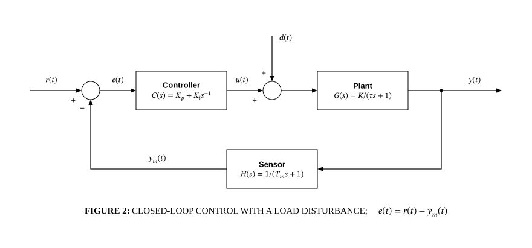

# Feedback control loop

## Bill of Materials

| Symbol / ID | Label | Kind | Group | Technical Notes / Metadata |
| :--- | :--- | :--- | :--- | :--- |
| `shape_1` | **** | box | - | - |
| `shape_2` | ****Controller** $C(s) = K_p + K_i s^{-1}$** | box | - | - |
| `shape_3` | **** | box | - | - |
| `shape_4` | ****Plant** $G(s) = K / (\tau s + 1)$** | box | - | - |
| `shape_5` | ****Sensor** $H(s) = 1 / (T_m s + 1)$** | box | - | - |

## Connections

| Source | Target | Protocol / Label | Style | Routing |
| :--- | :--- | :--- | :--- | :--- |
| **point_7** (`point_7`) | **shape_1** (`shape_1`) | - | solid | direct |
| **shape_1** (`shape_1`) | ****Controller** $C(s) = K_p + K_i s^{-1}$** (`shape_2`) | - | solid | orthogonal |
| ****Controller** $C(s) = K_p + K_i s^{-1}$** (`shape_2`) | **shape_3** (`shape_3`) | - | solid | orthogonal |
| **shape_3** (`shape_3`) | ****Plant** $G(s) = K / (\tau s + 1)$** (`shape_4`) | - | solid | orthogonal |
| ****Plant** $G(s) = K / (\tau s + 1)$** (`shape_4`) | **point_6** (`point_6`) | - | solid | direct |
| **point_6** (`point_6`) | **point_8** (`point_8`) | - | solid | direct |
| **point_9** (`point_9`) | **shape_3** (`shape_3`) | - | solid | direct |
| **point_6** (`point_6`) | ****Sensor** $H(s) = 1 / (T_m s + 1)$** (`shape_5`) | - | solid | orthogonal |
| ****Sensor** $H(s) = 1 / (T_m s + 1)$** (`shape_5`) | **shape_1** (`shape_1`) | - | solid | orthogonal |
