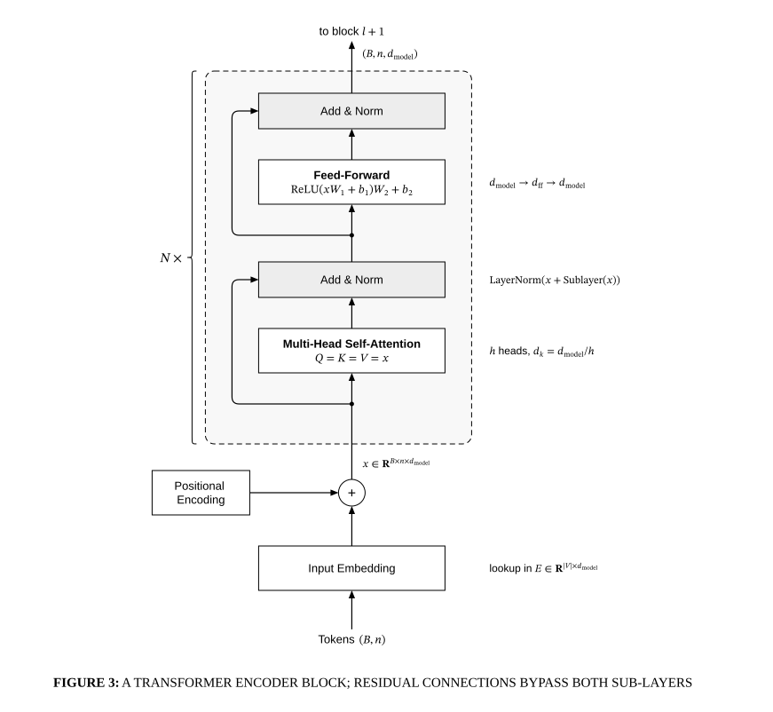

# Transformer encoder block

## Bill of Materials

| Symbol / ID | Label | Kind | Group | Technical Notes / Metadata |
| :--- | :--- | :--- | :--- | :--- |
| `shape_1` | **** | box | - | - |
| `shape_2` | **Add & Norm** | box | - | - |
| `shape_3` | ****Feed-Forward** $\mathrm{ReLU}(x W_1 + b_1) W_2 + b_2$** | box | - | - |
| `shape_4` | **Add & Norm** | box | - | - |
| `shape_5` | ****Multi-Head Self-Attention** $Q = K = V = x$** | box | - | - |
| `shape_6` | **+** | box | - | - |
| `shape_7` | **Input Embedding** | box | - | - |
| `shape_8` | **Positional Encoding** | box | - | - |

## Connections

| Source | Target | Protocol / Label | Style | Routing |
| :--- | :--- | :--- | :--- | :--- |
| **Tokens $(B, n)$** (`text_9`) | **Input Embedding** (`shape_7`) | - | solid | orthogonal |
| **Input Embedding** (`shape_7`) | **+** (`shape_6`) | - | solid | orthogonal |
| **Positional Encoding** (`shape_8`) | **+** (`shape_6`) | - | solid | orthogonal |
| **+** (`shape_6`) | ****Multi-Head Self-Attention** $Q = K = V = x$** (`shape_5`) | - | solid | orthogonal |
| ****Multi-Head Self-Attention** $Q = K = V = x$** (`shape_5`) | **Add & Norm** (`shape_4`) | - | solid | orthogonal |
| **Add & Norm** (`shape_4`) | ****Feed-Forward** $\mathrm{ReLU}(x W_1 + b_1) W_2 + b_2$** (`shape_3`) | - | solid | orthogonal |
| ****Feed-Forward** $\mathrm{ReLU}(x W_1 + b_1) W_2 + b_2$** (`shape_3`) | **Add & Norm** (`shape_2`) | - | solid | orthogonal |
| **Add & Norm** (`shape_2`) | **to block $l + 1$** (`text_10`) | - | solid | orthogonal |
| **point_11** (`point_11`) | **Add & Norm** (`shape_4`) | - | solid | orthogonal |
| **point_12** (`point_12`) | **Add & Norm** (`shape_2`) | - | solid | orthogonal |
