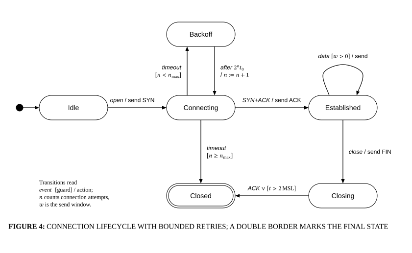

# Connection state machine

## Bill of Materials

| Symbol / ID | Label | Kind | Group | Technical Notes / Metadata |
| :--- | :--- | :--- | :--- | :--- |
| `shape_1` | **** | box | - | - |
| `shape_2` | **Idle** | box | - | - |
| `shape_3` | **Connecting** | box | - | - |
| `shape_4` | **Established** | box | - | - |
| `shape_5` | **Backoff** | box | - | - |
| `shape_6` | **Closing** | box | - | - |
| `shape_7` | **Closed** | box | - | - |

## Connections

| Source | Target | Protocol / Label | Style | Routing |
| :--- | :--- | :--- | :--- | :--- |
| **shape_1** (`shape_1`) | **Idle** (`shape_2`) | - | solid | orthogonal |
| **Idle** (`shape_2`) | **Connecting** (`shape_3`) | - | solid | orthogonal |
| **Connecting** (`shape_3`) | **Established** (`shape_4`) | - | solid | orthogonal |
| **Established** (`shape_4`) | **Closing** (`shape_6`) | - | solid | orthogonal |
| **Closing** (`shape_6`) | **Closed** (`shape_7`) | - | solid | orthogonal |
| **Connecting** (`shape_3`) | **Closed** (`shape_7`) | - | solid | orthogonal |
| **Connecting** (`shape_3`) | **Backoff** (`shape_5`) | - | solid | orthogonal |
| **Backoff** (`shape_5`) | **Connecting** (`shape_3`) | - | solid | orthogonal |
| **Established** (`shape_4`) | **Established** (`shape_4`) | - | solid | spline |
