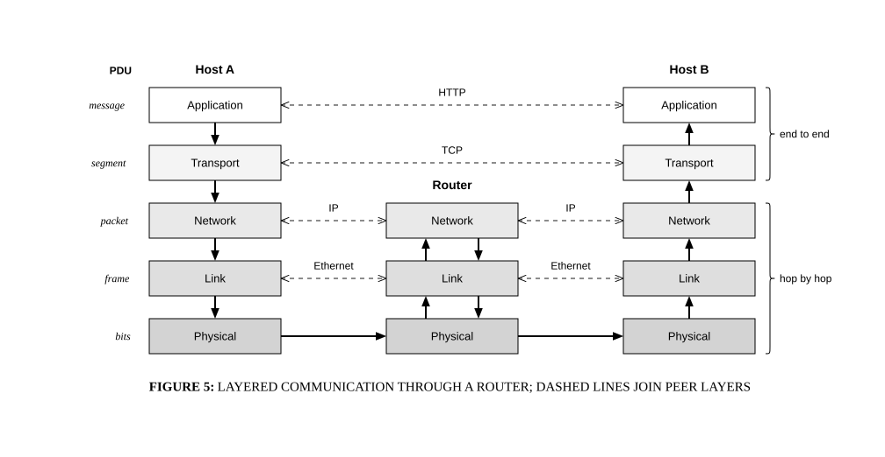

# Protocol stacks

## Bill of Materials

| Symbol / ID | Label | Kind | Group | Technical Notes / Metadata |
| :--- | :--- | :--- | :--- | :--- |
| `shape_2` | **Application** | box | - | - |
| `shape_3` | **Transport** | box | - | - |
| `shape_4` | **Network** | box | - | - |
| `shape_5` | **Link** | box | - | - |
| `shape_6` | **Physical** | box | - | - |
| `shape_8` | **Network** | box | - | - |
| `shape_9` | **Link** | box | - | - |
| `shape_10` | **Physical** | box | - | - |
| `shape_12` | **Application** | box | - | - |
| `shape_13` | **Transport** | box | - | - |
| `shape_14` | **Network** | box | - | - |
| `shape_15` | **Link** | box | - | - |
| `shape_16` | **Physical** | box | - | - |

## Connections

| Source | Target | Protocol / Label | Style | Routing |
| :--- | :--- | :--- | :--- | :--- |
| **Application** (`shape_2`) | **Application** (`shape_12`) | - | dashed | orthogonal |
| **Transport** (`shape_3`) | **Transport** (`shape_13`) | - | dashed | orthogonal |
| **Network** (`shape_4`) | **Network** (`shape_8`) | - | dashed | orthogonal |
| **Network** (`shape_8`) | **Network** (`shape_14`) | - | dashed | orthogonal |
| **Link** (`shape_5`) | **Link** (`shape_9`) | - | dashed | orthogonal |
| **Link** (`shape_9`) | **Link** (`shape_15`) | - | dashed | orthogonal |
| **Application** (`shape_2`) | **Transport** (`shape_3`) | - | solid | orthogonal |
| **Transport** (`shape_13`) | **Application** (`shape_12`) | - | solid | orthogonal |
| **Transport** (`shape_3`) | **Network** (`shape_4`) | - | solid | orthogonal |
| **Network** (`shape_14`) | **Transport** (`shape_13`) | - | solid | orthogonal |
| **Network** (`shape_4`) | **Link** (`shape_5`) | - | solid | orthogonal |
| **Link** (`shape_15`) | **Network** (`shape_14`) | - | solid | orthogonal |
| **Link** (`shape_9`) | **Network** (`shape_8`) | - | solid | orthogonal |
| **Network** (`shape_8`) | **Link** (`shape_9`) | - | solid | orthogonal |
| **Link** (`shape_5`) | **Physical** (`shape_6`) | - | solid | orthogonal |
| **Physical** (`shape_16`) | **Link** (`shape_15`) | - | solid | orthogonal |
| **Physical** (`shape_10`) | **Link** (`shape_9`) | - | solid | orthogonal |
| **Link** (`shape_9`) | **Physical** (`shape_10`) | - | solid | orthogonal |
| **Physical** (`shape_6`) | **Physical** (`shape_10`) | - | solid | orthogonal |
| **Physical** (`shape_10`) | **Physical** (`shape_16`) | - | solid | orthogonal |
