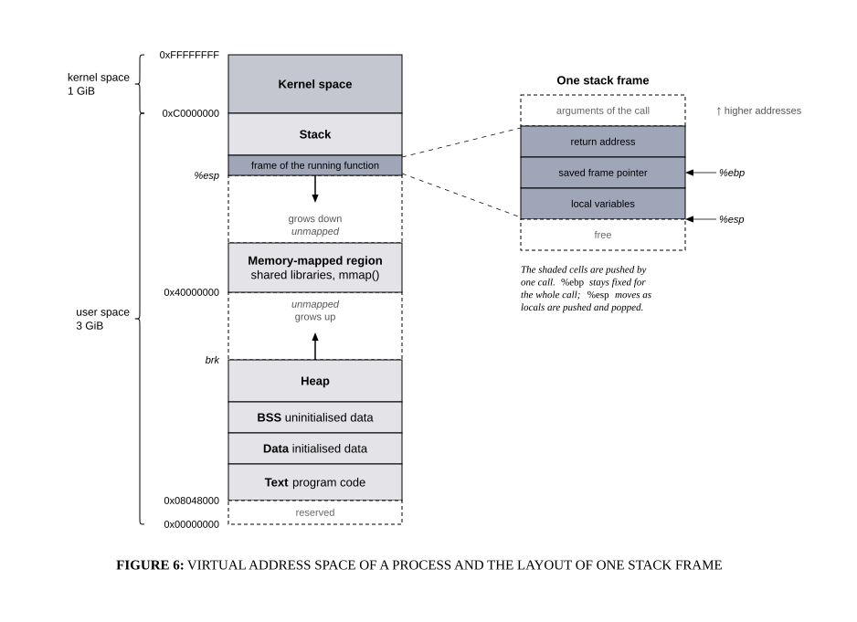

# Process memory layout

## Bill of Materials

| Symbol / ID | Label | Kind | Group | Technical Notes / Metadata |
| :--- | :--- | :--- | :--- | :--- |
| `shape_2` | ****Kernel space**** | box | - | - |
| `shape_4` | ****Stack**** | box | - | - |
| `shape_5` | **frame of the running function** | box | - | - |
| `shape_7` | **** | box | - | - |
| `shape_8` | ****Memory-mapped region** shared libraries, mmap()** | box | - | - |
| `shape_10` | **** | box | - | - |
| `shape_12` | ****Heap**** | box | - | - |
| `shape_13` | ****BSS** uninitialised data** | box | - | - |
| `shape_14` | ****Data** initialised data** | box | - | - |
| `shape_15` | ****Text** program code** | box | - | - |
| `shape_17` | **reserved** | box | - | - |
| `shape_26` | **arguments of the call** | box | - | - |
| `shape_27` | **return address** | box | - | - |
| `shape_28` | **saved frame pointer** | box | - | - |
| `shape_29` | **local variables** | box | - | - |
| `shape_30` | **free** | box | - | - |

## Connections

| Source | Target | Protocol / Label | Style | Routing |
| :--- | :--- | :--- | :--- | :--- |
| **frame of the running function** (`shape_5`) | **point_19** (`point_19`) | - | solid | direct |
| ****Heap**** (`shape_12`) | **point_21** (`point_21`) | - | solid | direct |
| **frame of the running function** (`shape_5`) | **return address** (`shape_27`) | - | dashed | direct |
| **frame of the running function** (`shape_5`) | **local variables** (`shape_29`) | - | dashed | direct |
| ***%ebp*** (`text_31`) | **saved frame pointer** (`shape_28`) | - | solid | direct |
| ***%esp*** (`text_32`) | **point_33** (`point_33`) | - | solid | direct |
