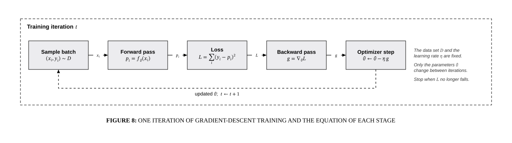

# Training pipeline

## Bill of Materials

| Symbol / ID | Label | Kind | Group | Technical Notes / Metadata |
| :--- | :--- | :--- | :--- | :--- |
| `shape_2` | ****Sample batch** $(x_i, y_i) \sim D$** | box | Training iteration $t$ | - |
| `shape_3` | ****Forward pass** $p_i = f_\theta(x_i)$** | box | Training iteration $t$ | - |
| `shape_4` | ****Loss** $L = \sum_i (y_i - p_i)^2$** | box | Training iteration $t$ | - |
| `shape_5` | ****Backward pass** $g = \nabla_\theta L$** | box | Training iteration $t$ | - |
| `shape_6` | ****Optimizer step** $\theta \leftarrow \theta - \eta\,g$** | box | Training iteration $t$ | - |

## Connections

| Source | Target | Protocol / Label | Style | Routing |
| :--- | :--- | :--- | :--- | :--- |
| ****Sample batch** $(x_i, y_i) \sim D$** (`shape_2`) | ****Forward pass** $p_i = f_\theta(x_i)$** (`shape_3`) | $x_i$ | solid | orthogonal |
| ****Forward pass** $p_i = f_\theta(x_i)$** (`shape_3`) | ****Loss** $L = \sum_i (y_i - p_i)^2$** (`shape_4`) | $p_i$ | solid | orthogonal |
| ****Loss** $L = \sum_i (y_i - p_i)^2$** (`shape_4`) | ****Backward pass** $g = \nabla_\theta L$** (`shape_5`) | $L$ | solid | orthogonal |
| ****Backward pass** $g = \nabla_\theta L$** (`shape_5`) | ****Optimizer step** $\theta \leftarrow \theta - \eta\,g$** (`shape_6`) | $g$ | solid | orthogonal |
| ****Optimizer step** $\theta \leftarrow \theta - \eta\,g$** (`shape_6`) | ****Sample batch** $(x_i, y_i) \sim D$** (`shape_2`) | - | dashed | direct |
