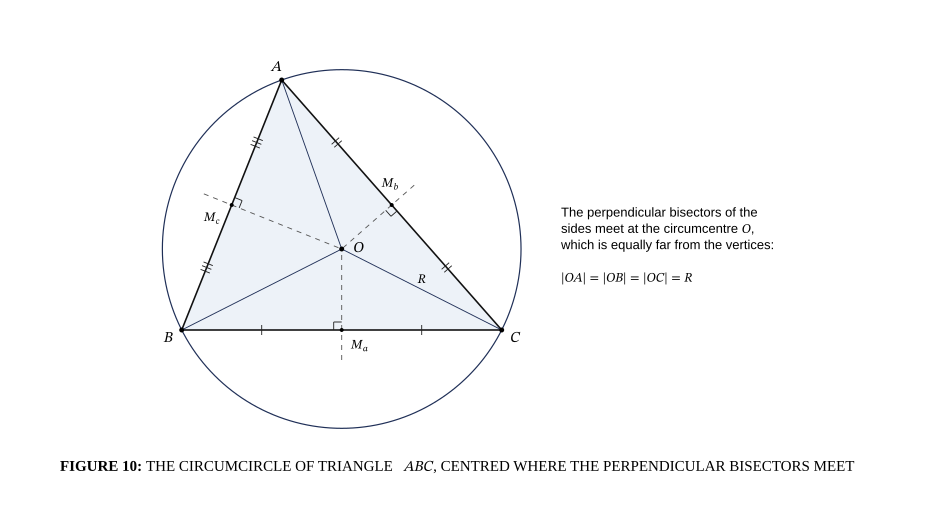

# Circumcircle of a triangle

## Bill of Materials

| Symbol / ID | Label | Kind | Group | Technical Notes / Metadata |
| :--- | :--- | :--- | :--- | :--- |

## Connections

| Source | Target | Protocol / Label | Style | Routing |
| :--- | :--- | :--- | :--- | :--- |
| **point_4** (`point_4`) | **point_3** (`point_3`) | - | dashed | direct |
| **point_7** (`point_7`) | **point_3** (`point_3`) | - | dashed | direct |
| **point_10** (`point_10`) | **point_3** (`point_3`) | - | dashed | direct |
| **point_3** (`point_3`) | **point_14** (`point_14`) | - | solid | direct |
| **point_3** (`point_3`) | **point_16** (`point_16`) | - | solid | direct |
| **point_3** (`point_3`) | **point_18** (`point_18`) | - | solid | direct |
