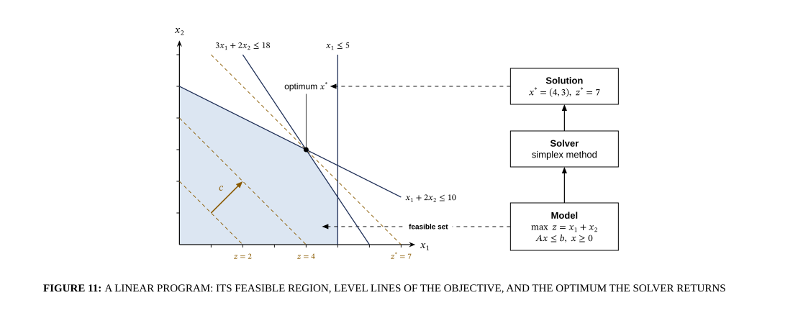

# Feasible region of a linear program

## Bill of Materials

| Symbol / ID | Label | Kind | Group | Technical Notes / Metadata |
| :--- | :--- | :--- | :--- | :--- |
| `shape_26` | ****Model** $\max\; z = x_1 + x_2$ $A x \leq b,\; x \geq 0$** | box | - | - |
| `shape_27` | ****Solver** simplex method** | box | - | - |
| `shape_28` | ****Solution** $x^* = (4, 3),\; z^* = 7$** | box | - | - |

## Connections

| Source | Target | Protocol / Label | Style | Routing |
| :--- | :--- | :--- | :--- | :--- |
| **point_15** (`point_15`) | **point_16** (`point_16`) | - | solid | direct |
| **point_17** (`point_17`) | **point_18** (`point_18`) | - | solid | direct |
| **point_21** (`point_21`) | **point_22** (`point_22`) | - | solid | direct |
| **optimum $x^*$** (`text_25`) | **point_24** (`point_24`) | - | solid | direct |
| ****Model** $\max\; z = x_1 + x_2$ $A x \leq b,\; x \geq 0$** (`shape_26`) | ****Solver** simplex method** (`shape_27`) | - | solid | orthogonal |
| ****Solver** simplex method** (`shape_27`) | ****Solution** $x^* = (4, 3),\; z^* = 7$** (`shape_28`) | - | solid | orthogonal |
| ****Model** $\max\; z = x_1 + x_2$ $A x \leq b,\; x \geq 0$** (`shape_26`) | **point_29** (`point_29`) | feasible set | dashed | direct |
| ****Solution** $x^* = (4, 3),\; z^* = 7$** (`shape_28`) | **optimum $x^*$** (`text_25`) | - | dashed | direct |
